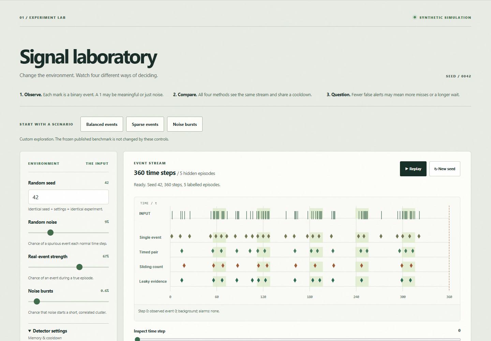
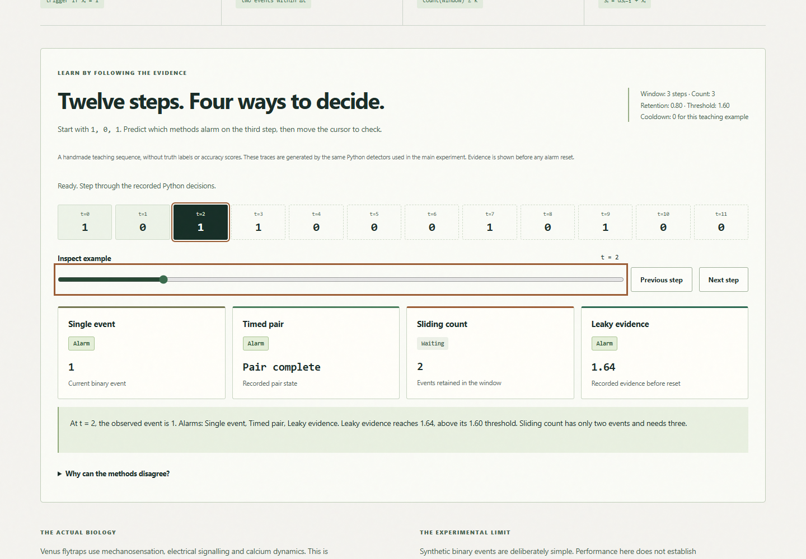

# DIONAEA.

**A small, research-led Computer Science project inspired by the Venus flytrap and an in-person Biomimicry Trail at Oxford Botanic Garden.**

**Research question:** *Can short-term temporal evidence integration suppress false activations in noisy event streams, and what is lost in detection responsiveness?*

This is a **working, AI-assisted starter project**, intended to be studied, challenged and independently extended by a Year 12/13 student. It is not an original plant model or a claim to have invented anomaly detection. Scientific interpretation, synthetic experiments and author contributions are carefully separated.

[Live laboratory](https://dionaea-seven.vercel.app) · [GitHub source](https://github.com/mithilkatkoria/dionaea)

## The project story

The starting point was an in-person visit to Oxford Botanic Garden during the St John's Inspire summer-school Biomimicry Trail, with the original leaflet retained by the student. Further reading about flytrap signalling motivated a computational question about brief temporal memory. The visit supplies personal motivation, not measurements or institutional endorsement. This is an independent learning project; Oxford has not reviewed or endorsed it.

The browser laboratory compares four standard, causal detectors on the same synthetic binary stream. Guided presets help you explore balanced events, sparse genuine events and burst noise. A twelve-step teaching example shows the recorded state of all four methods, with no JavaScript duplicate of the algorithms. Change the controls, use Replay/Pause, inspect any revealed step with the keyboard or touch, reset the settings, or download the current synthetic CSV. The methods, saved held-out results, scientific sources and limitations sit alongside the experiment.



## Quick start (Windows, macOS, Linux)

Requires **Python 3.10 or newer**, no external Python packages. On Windows, you can also double-click `start_windows.bat` (provided Python is installed).

```bash
python app.py
```

Open **http://127.0.0.1:8765** in your browser. Change noise, burstiness, memory window, threshold and random seed. Watch the alarm timeline and true-episode scores update. Use *Replay* to show time progressing; the algorithms cannot see future signals.

Then run:

```bash
python -m unittest discover -s tests -v
python -m dionaea.benchmark
```

The benchmark regenerates `experiments/RESULTS.md` and `experiments/benchmark_results.json` from deterministic seeds.

### Optional: your own recorded events

Prepare a CSV with `t,event,label` (see `docs/FIELD_STUDY.md`) and run:

```bash
python -m dionaea.field_data your_observations.csv
```

This records event-level evidence and pre-labelled true episodes without using model predictions to create truth labels.

## Contents

```text
app.py                      local development HTTP server
api/                        Vercel Python entrypoints
dionaea/http_api.py          shared local/production HTTP boundary
vercel.json                 Python functions + static public output
public/index.html              browser lab and methodology
public/style.css               original responsive lab design
public/main.js                 interactive event timeline
public/learning.js             step-by-step trace reader
public/learning-example.json    fixed teaching trace generated by Python
scripts/build_learning_example.py  regenerate the trace after an engine change

dionaea/model.py            seeded synthetic stream generator
dionaea/detectors.py        four causal, explainable algorithms
dionaea/evaluate.py         episode-level metrics
dionaea/benchmark.py        train / held-out test comparison
dionaea/field_data.py       evaluate independent CSV observations

tests/                      automated correctness tests
experiments/RESULTS.md      genuine reproducible simulated results
experiments/benchmark_results.json  structured version of those results

docs/RESEARCH.md            science, methodology, sources and caveats
docs/STUDENT_WORKBOOK.md    six-week programme + interview questions
docs/LAB_NOTEBOOK.md        ownership and experiment journal
docs/EXPLAINED_FROM_ZERO.md Year 12 mathematics + CS walkthrough
docs/FIELD_STUDY.md         simple independent data-collection method
```

## Mathematics

The leaky integrator is defined as:

```text
S_t = alpha * S_(t-1) + x_t
trigger when S_t >= threshold
```

`x_t` is binary. `alpha` is a retention coefficient in the interval [0,1), *not* a measured plant constant. Timed pair and sliding count offer other simple decision rules. All four detectors share the same alarm cooldown and see the same event sequence.

## Fair comparison and limitations

The preconfigured benchmark chooses settings on **15 training seeds** from a moderate-noise scenario. It freezes those settings and tests the four algorithms on **40 held-out seeds** across each of **four environments**, using an explicitly stated subjective cost formula. `experiments/RESULTS.md` reports *the actual outputs of the included code*; it is not a prestigious external leaderboard score. A less cautious baseline may detect more episodes while producing more false alerts. The algorithms are standard well-known approaches.

Read `docs/RESEARCH.md` and `docs/STUDENT_WORKBOOK.md` before publishing your own claims or discussing the project in applications. The biggest admissions value comes from understanding the mathematics, making an independent change, documenting experiments and discussing the **limitations**, not from copying the starter application.

## Suggested next step

Investigate whether the memory parameter should adapt to changes in background event rate. Write a prediction first, design an online-only estimator and compare against the fixed-parameter detectors on *unseen* seeds. Alternatively, choose the simpler false-positive-cost sensitivity experiment in the workbook.

## References

- Oxford Botanic Garden, *Biomimetics*. https://www.botanic-garden.ox.ac.uk/biomimetics-exploiting-plants-design-technology
- Hedrich & Kreuzer (2023), *Demystifying the Venus flytrap action potential*. https://doi.org/10.1111/nph.19113
- Suda et al. (2020), *Calcium dynamics during trap closure visualized in transgenic Venus flytrap*. https://doi.org/10.1038/s41477-020-00773-1
- Oxford CS personal statements: https://www.cs.ox.ac.uk/admissions/undergraduate/how_to_apply/personal-statement.html
- Cambridge guidance: https://www.undergraduate.study.cam.ac.uk/apply/how/ucas-personal-statement
- UCAS 2026-onwards personal statement format: https://www.ucas.com/applying/applying-to-university/writing-your-personal-statement/how-to-write-your-personal-statement-for-2026-entry-onwards

## Academic honesty / ownership

Starter code and documentation were generated with AI assistance. Before describing this as **your project** in an application, understand how it works, validate the results, make and document meaningful independent contributions, and describe who did what accurately. Repositories may honestly say *'Initially scaffolded with AI assistance; experimental design and analysis by [name]'* **only when that latter clause becomes true**.

You should not claim that Oxford reviewed or endorsed this code, that the algorithms are new, or that the benchmarks involve physical Venus flytraps.

## Licence

The original project code and written instructions may be reused and modified for educational purposes. Third-party research linked above retains its authors' copyright.

## Published synthetic results

| Environment | Single cost | Pair cost | Count cost | Leaky cost |
| --- | ---: | ---: | ---: | ---: |
| moderate / independent noise | 45.51 | 16.02 | 5.34 | 5.02 |
| sparse true events | 40.41 | 13.42 | 14.63 | 15.34 |
| high background noise | 67.32 | 35.30 | 8.19 | 7.43 |
| correlated noise bursts | 46.05 | 23.62 | 10.97 | 10.38 |

Lower cost means fewer mistakes under `4*FN + 2*FP + 0.03*sum(first_detection_delays)`. These weights are subjective. On moderate noise, the single-event baseline detects all episodes but produces 22.62 false alerts per stream on average; the selected leaky detector reduces false alerts to 1.52 while recall falls to 94.5%. In sparse true events, the timed pair has the lowest mean cost. This does not establish universal superiority. See [the full report](experiments/RESULTS.md) for precision, recall, variability and selected parameters.

Pair and count windows include timestamps at exactly `t - window`. A cooldown of 6 ignores the six steps after an alarm. Detector evidence resets on an alarm. Delay is reported for detected episodes only. The interactive defaults are teaching settings, not the frozen settings selected by the benchmark.

## Reproduce the quality checks

```sh
python -m unittest discover -s tests -v
python -m dionaea.benchmark
python -m scripts.check_reproducibility
node --check public/main.js
node --check public/learning.js
python -m compileall -q .
```

The reproducibility command compares both report files byte-for-byte against their saved values. The original detector logic, training seeds and held-out seeds are retained. Report writes use LF on all platforms so Windows and Linux reproduce the same bytes.

For browser QA only, install Node.js 22+ and run:

```sh
npm ci
npx playwright install chromium
npm run test:browser
python -m scripts.production_check https://dionaea-seven.vercel.app
```

The script starts a local Python server if needed. To test a deployed site, set `BASE_URL` to its real HTTPS URL. Set `BROWSER_CHANNEL=msedge` to use an existing Edge installation. The browser suite checks the five specified widths, controls, keyboard/touch inspection, replay, failures, CSV export and WCAG A/AA rules using axe-core. These automated checks do not replace testing with real assistive technology.

## Deployment architecture

`public/` is the only frontend. `app.py` serves it locally. `api/simulate.py`, `api/benchmark.py` and `api/health.py` are standard-library Vercel Python entrypoints that import the same `dionaea/http_api.py` boundary and engine. There is no JavaScript implementation of the algorithms and no Python runtime dependency to install.

Vercel uses framework **Other**, static output `public`, no build/install command, and Python 3.12 selected by `.python-version`. The benchmark endpoint returns the saved reproducible JSON, rather than retuning on a request. Simulations and health responses are not cached. Static CSS and JavaScript must revalidate; benchmark JSON may be cached at the edge for an hour. The configuration follows the [official Python runtime documentation](https://vercel.com/docs/functions/runtimes/python) and [project configuration documentation](https://vercel.com/docs/project-configuration/vercel-json).

All query values are bounded and validated; duplicate, unknown, empty and non-finite inputs return JSON 400 errors. Unsupported API methods return 405. Static source/private files are not served. Security headers restrict scripts and network requests to this origin and disallow embedding. `.env`, `.vercel`, keys and QA dependencies are excluded from Git. No DNS changes or custom domains are required.

See [the publishing checklist](docs/PUBLISHING_CHECKLIST.md) and [deployment audit](docs/DEPLOYMENT_REPORT.md) for verified links and evidence.

## Responsible contribution record

- The imported starter, explanatory documents and synthetic benchmark were initially AI-assisted.
- Production HTTP boundaries, browser accessibility/error handling, deployment configuration and QA were also developed with Codex assistance. This does not claim that the student independently implemented or experimentally validated them.
- Student hypotheses, calculations, readings, code changes and findings remain to be recorded by the student in [the research journal template](docs/RESEARCH_JOURNAL_TEMPLATE.md). The template intentionally contains no personal findings.
- Git history is current and truthful. The imported starter is recorded separately from the production changes; no commits were backdated.

Known limits: synthetic binary data; subjective cost weights and cooldown; fixed scenario generator; no significance testing or physical sensor validation; mean detection delay excludes missed episodes; no original detector or physiological simulator is claimed. Reusing the existing held-out seeds for further tuning would invalidate their status as an untouched test set.

## Learn the rules on the site



Open [the worked example](https://dionaea-seven.vercel.app/#worked-example) and move to t = 2. For inputs 1, 0, 1, leaky evidence is 1, 0.8, 1.64, so it crosses the teaching threshold 1.6. A pair has also completed, but sliding count has only two events and needs three. At t = 3 the count fires, while leaky evidence starts again at 1 after its reset. The teaching example deliberately uses cooldown zero; the main laboratory starts with cooldown six.

The static teaching JSON is generated with the production `detect()` function. Regenerate it after intentionally changing the engine:

```sh
python -m scripts.build_learning_example
```

A test checks that the served example remains consistent with the engine. The published benchmark files and train/test seeds are separate and unchanged. Presets use shared exploratory settings rather than the independently selected per-method benchmark settings.

The findings section now includes detected-only delay and explains each environment's false-alert/recall trade-off. The [make it yours section](https://dionaea-seven.vercel.app/#your-project) links to the blank journal, workbook and field-study method. This educational website update was implemented with Codex assistance. It is not a claim of an independently conducted student extension.
